# Superstore Sales & Profitability Analysis

### SQL Server Management Studio (SSMS) | Power BI | SQL Query | DAX | Data Analytics

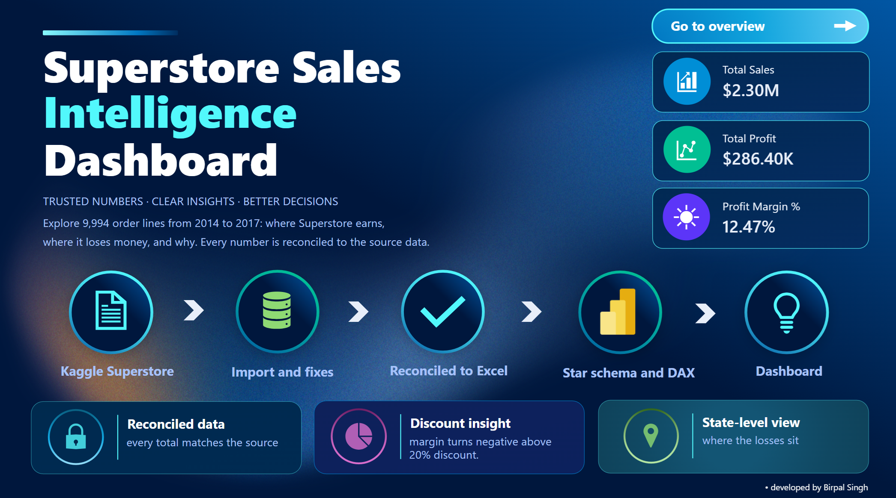

[](https://www.microsoft.com/en-us/sql-server)
[](https://powerbi.microsoft.com/)
[-00D4FF)](#-data-modeling-star-schema-architecture)
[](#-sql--source-reconciliation-data-lock)
---

## 1. 📌 Project Overview

This is an end-to-end sales and profitability analysis project built using SQL Server and Power BI.

I started with the Sample Superstore dataset and worked through the complete process: importing the raw data, checking data quality, fixing import-related issues, writing SQL queries, building a data model, creating DAX measures, and developing an interactive seven-page Power BI report.

The main question I wanted to investigate was:

> **Are the products and regions generating the highest sales actually contributing the most profit?**

The analysis revealed something interesting: some of the highest-selling products and categories were barely profitable or were actually generating losses.

One finding stood out in particular. Transactions with discounts above 20% generated a combined loss of approximately **$135,376**, representing around 47% of the company's overall profit when measured against the total profit baseline.

Rather than stopping at historical reporting, I also built an interactive simulation page to explore how discount adjustments and price changes could affect profitability, along with a separate 12-month forecasting view.

This project is not just about presenting sales figures. It is about understanding what is happening behind those figures and identifying where business decisions could make a difference.

### Project at a Glance

| Item              | Details                                       |
| ----------------- | --------------------------------------------- |
| Project           | Superstore Sales & Profitability Analysis     |
| Database          | Microsoft SQL Server Express                  |
| Query Tool        | SQL Server Management Studio (SSMS)           |
| Visualization     | Power BI Desktop                              |
| Data Modeling     | Star Schema                                   |
| Query Analysis    | 10 Business-driven SQL Queries                |
| Power BI Report   | 7 Interactive Pages                           |
| DAX               | Measures, Time Intelligence, What-If Analysis |
| Forecasting       | 12-month Holt-Winters Additive Seasonality    |
| Dataset Period    | 2014–2017                                     |
| Total Order Lines | 9,994                                         |
| Total Orders      | 5,009                                         |

---

## 2. Business Problems I Wanted to Solve

A sales report can show that revenue is increasing, but that doesn't necessarily mean the business is becoming more profitable.

I focused on six business questions:

1. **Product Profitability:** Which categories and sub-categories are actually making money, and which ones are creating losses?
2. **Discount Impact:** At what discount level does profitability start becoming a problem?
3. **Regional Performance:** Which regions and states contribute the most profit, and where are the biggest losses?
4. **Customer Analysis:** Are the highest-revenue customers also profitable customers?
5. **Operational Performance:** How do shipping methods and customer segments affect sales and profitability?
6. **Future Planning:** How much profit could potentially be recovered through better discount management and price adjustments?

The objective was to answer these questions using actual query results rather than relying on assumptions or attractive-looking visuals.

---

## 3. Tools & Technologies

| Tool                         | How I Used It                                                       |
| ---------------------------- | ------------------------------------------------------------------- |
| SQL Server Express           | Imported and stored the dataset, performed data checks and analysis |
| SQL Server Management Studio | Wrote and executed SQL queries                                      |
| Power BI Desktop             | Built the data model, DAX measures and interactive report           |
| DAX                          | Created KPIs, time-intelligence calculations and simulation logic   |
| Microsoft Excel              | Compared source data against SQL Server results                     |
| Microsoft PowerPoint         | Designed report backgrounds and page layouts                        |
| SVG                          | Created sharp, scalable dashboard background elements               |
| GitHub                       | Maintained project files and documented the complete workflow       |
| Ai Partner                   | Claude, DeepSeek, Arena Ai                                          |

### SQL Skills Used

- SELECT, WHERE, ORDER BY
- GROUP BY and HAVING
- Aggregate functions: SUM, AVG, COUNT
- COUNT(DISTINCT)
- CASE statements
- Common Table Expressions (CTEs)
- Window Functions
- LAG()
- ROW_NUMBER()
- Date calculations using DATEDIFF()
- SQL Views
- Data type conversion
- Data quality checks
- Source reconciliation

### Power BI Skills Used

- Data transformation and loading
- Star Schema data modeling
- Fact and dimension tables
- One-to-many relationships
- Single-direction filtering
- Calculated tables
- DAX measures
- CALCULATE and FILTER
- DIVIDE and DISTINCTCOUNT
- SAMEPERIODLASTYEAR
- Time intelligence
- What-If parameters
- Conditional formatting
- Custom report-page tooltips
- Bookmarks and interactive navigation
- Dynamic titles and insight banners
- Forecasting and scenario analysis

---

## 4. Dataset Information

**Dataset:** Sample Superstore

**Source:** [Sample Superstore Dataset – Kaggle](https://www.kaggle.com/datasets/vivek468/superstore-dataset-final)

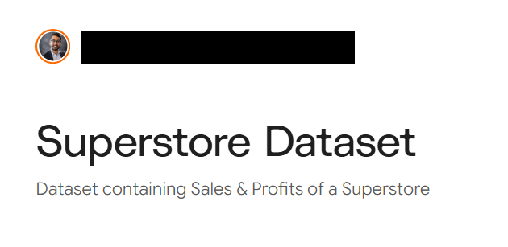

The dataset contains historical retail transactions covering four years, from January 2014 to December 2017.

| Dataset Information | Value               |
| ------------------- | ------------------- |
| Total Rows          | 9,994               |
| Total Columns       | 21                  |
| Distinct Orders     | 5,009               |
| Distinct Customers  | 793                 |
| Distinct Products   | 1,850 product names |
| Product IDs         | 1,862               |
| Categories          | 3                   |
| Sub-Categories      | 17                  |
| States              | 49                  |
| Regions             | 4                   |
| Date Range          | 2014–2017           |

**Data Grain:** One row represents one product line within an order.

Some important columns used throughout the analysis:

| Column       | Purpose                  |
| ------------ | ------------------------ |
| Order_ID     | Unique order reference   |
| Order_Date   | Order transaction date   |
| Ship_Date    | Shipping date            |
| Customer_ID  | Customer identification  |
| Product_ID   | Product identification   |
| Category     | Main product category    |
| Sub_Category | Product sub-category     |
| Region       | Sales region             |
| State        | Customer location        |
| Sales        | Revenue generated        |
| Quantity     | Units sold               |
| Discount     | Discount applied         |
| Profit       | Profit or loss generated |
| Ship_Mode    | Shipping method          |

The dataset is publicly available and contains no real customer personally identifiable information.

---

## 5. Data Import & Data Quality

This was one of the most important parts of the project.

I initially imported the CSV file into SQL Server using the Import Flat File wizard. During the process, I encountered a few issues that could have affected the final analysis if they had gone unnoticed.

Instead of directly moving to SQL queries, I investigated these issues and verified the imported data against the original source.

### ⚠️ Issue 1: NULL Value During Import

During the initial import, SQL Server returned:

`Column 'Profit' does not allow DBNull.Value`

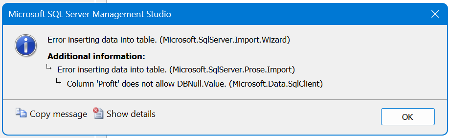

I allowed NULL values in the Profit column and reran the import.

However, the problem was not completely resolved.

### ⚠️ Issue 2: A Valid Profit Value Was Lost During Import

SQL Server displayed a warning:

`Up to 1 cells of data may have been dropped ... Profit`

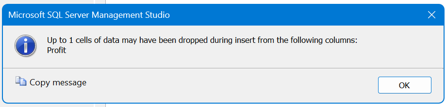

On checking the imported records, I found:

- Row_ID 7345 had `Profit = NULL`.
- The original CSV contained `Profit = -420`.
- The import wizard had failed to convert that cell.
- The exact reason for the conversion failure was not confirmed.

I corrected the affected record:

```
UPDATE superstore
SET Profit = -420
WHERE Row_ID = 7345;

SELECT Row_ID, Profit
FROM superstore
WHERE Row_ID = 7345;
```

The corrected value was verified.

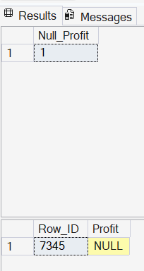 | 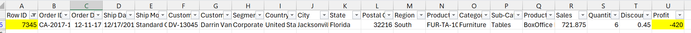

**What I learned:** A successful import does not automatically mean that all source values have been imported correctly. Import warnings, row counts and financial control totals should always be checked.

### ⚠️ Issue 3: Duplicate Records

I identified eight repeated `Order_ID + Product_ID` combinations, involving 16 rows.

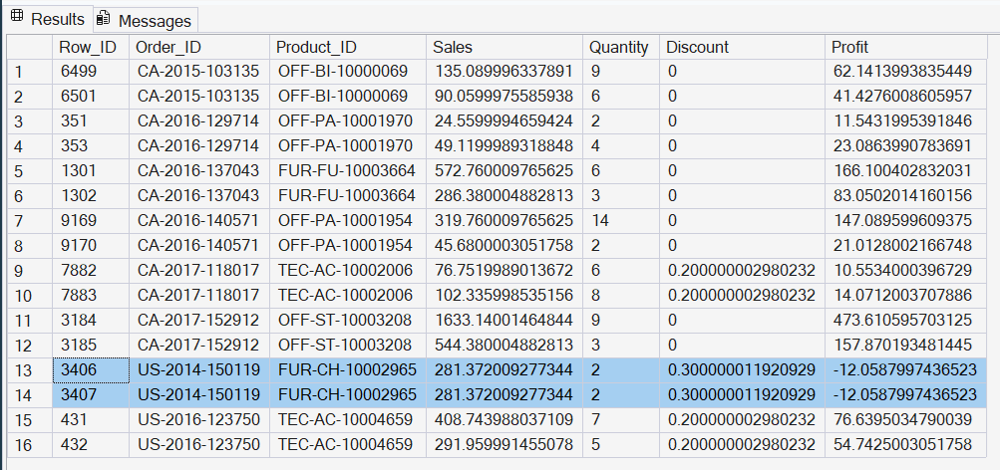 | 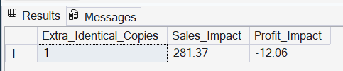

On investigation:

- Seven combinations represented legitimate separate line items.
- One combination contained two identical records, except for Row_ID.
- The identical records were Row_ID 3406 and 3407.
- Their combined impact was $281.37 in sales and -$12.06 in profit for the extra copy.

I retained the records as they appeared in the original source and documented the finding rather than automatically deleting them.

**What I learned:** A repeated key combination does not always mean that a record is incorrect. It is important to investigate the business meaning before removing data.

### ⚠️ Issue 4: FLOAT Precision and Discount Comparisons

This was particularly important because discount analysis was one of the main objectives of the project.

Initially, I executed:

```
SELECT COUNT(*)
FROM superstore
WHERE Discount = 0.2;
```

The result was zero, even though 20% was one of the most common discount values.

The reason was that the Import Flat File wizard had stored Discount as `float(53)`.

A value that was expected to be 0.2 was stored approximately as:

`0.200000002980232`

This caused exact comparisons to behave differently from what I expected.

For example, a discount band using `Discount <= 0.2` could incorrectly classify 20% transactions.

**Fix:**

First, I created a backup:

```
SELECT *
INTO superstore_backup_before_discount_fix
FROM superstore;
```

Then changed the column type:

```
ALTER TABLE superstore
ALTER COLUMN Discount decimal(3,2) NOT NULL;
```
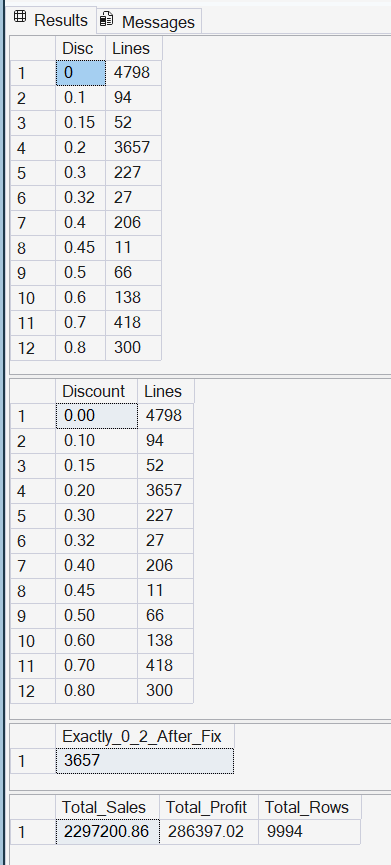 | 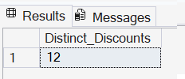

**Verification results:**

| Check                                  | Result        |
| -------------------------------------- | ------------- |
| Distinct Discount Values               | 12            |
| Transactions with Exactly 20% Discount | 3,657         |
| Rows Changed by ALTER                  | 0             |
| Total Rows                             | 9,994         |
| Total Sales                            | $2,297,200.86 |
| Total Profit                           | $286,397.02   |

The original sales and profit control totals remained unchanged.

**What I learned:** FLOAT is an approximate numeric data type. For percentages and exact threshold comparisons, DECIMAL is a better choice. For financial applications, monetary columns should also use an appropriate DECIMAL precision.

---

## 6. SQL Data Validation & Source Reconciliation

Before starting the analytical queries, I compared the SQL Server data against the original Excel/CSV source.

The purpose was to make sure that the data imported into SQL Server was consistent with the original dataset.

### Validation Summary

| Validation Check           | SQL Server Result        |
| -------------------------- | ------------------------ |
| Total Rows                 | 9,994                    |
| Distinct Orders            | 5,009                    |
| Customers                  | 793                      |
| Product IDs                | 1,862                    |
| Categories                 | 3                        |
| Sub-Categories             | 17                       |
| States                     | 49                       |
| Regions                    | 4                        |
| Shipping Modes             | 4                        |
| Date Range                 | 2014-01-03 to 2017-12-30 |
| Minimum Shipping Days      | 0                        |
| Maximum Shipping Days      | 7                        |
| NULL Values in Key Columns | 0                        |

### Financial Control Totals

These values became the baseline for the entire project.

| Metric       | SQL Server    | Original Source |
| ------------ | ------------- | --------------- |
| Total Rows   | 9,994         | 9,994           |
| Total Sales  | $2,297,200.86 | $2,297,200.86   |
| Total Profit | $286,397.02   | $286,397.02     |

### What I Compared

I performed six reconciliation checks:

1. Row count and financial totals.
2. Minimum and maximum transaction dates.
3. Distinct counts across important dimensions.
4. Category-wise Sales and Profit.
5. Row-level comparison using selected Row_IDs and Excel XLOOKUP.
6. Discount-band distribution between SQL Server and Excel.

The compared values matched.

This gave me a verified baseline before moving into business analysis.

---

## 7. SQL Analysis — 10 Business Questions

I wrote ten SQL queries to investigate different aspects of the business.

The queries are available in the repository:

- Q1–Q5 SQL Queries
- Q6–Q10 SQL Queries
- Data Checks and Fixes

### Q1. Category & Sub-Category Profitability

**Business Question:** Which product categories are generating actual profit?

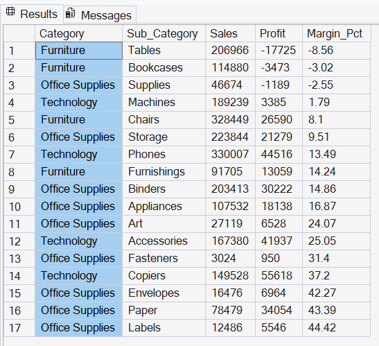

> **Finding:** Only 3 of 17 sub-categories have negative margin — **Tables −$17,725 (−8.56%)**, **Bookcases −$3,473 (−3.02%)**, **Supplies −$1,189 (−2.55%)**. Machines posts $189K sales but only **1.79%** margin. Largest profits: **Copiers $55,618 (37.2%)**, Phones $44,516, Accessories $41,937.
> **Means:** Revenue rankings hide loss-makers. Any category review must start with margin, not sales.

---

### Q2. Region-Wise Performance

**Business Question:** Which geographical regions contribute the most profit?

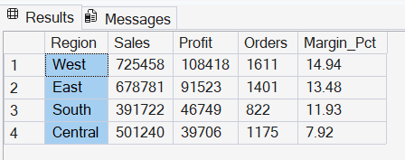

> **Finding:** **West** leads on profit (**$108,418**, margin **14.94%**). **Central** is weakest on both profit (**$39,706**) and margin (**7.92%**) despite $501K sales — South sells less ($392K) but earns more profit ($46,749).
> **Means:** High regional sales ≠ regional profit. Discount depth and mix differ by region.

---

### Q3. Monthly Sales Trend & Month-over-Month Growth

**Business Question:** Which months generate the highest sales, and when does the business experience the biggest declines?

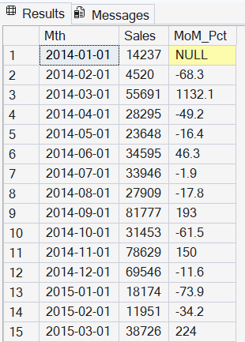 | 📸 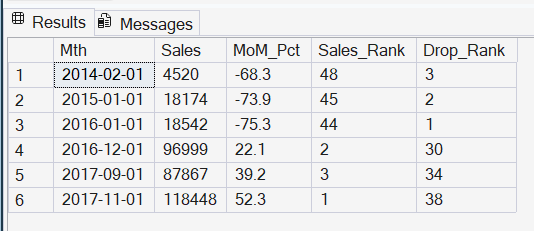

> **Finding:** Strongest individual months: **Nov 2017 ($118,448)**, **Dec 2016 ($96,999)**, **Sep 2017 ($87,867)**. Steepest MoM drops: **Jan 2016 (−75.3%)**, **Jan 2015 (−73.9%)**, **Feb 2014 (−68.3%)**. Across all years, calendar peaks sit in **Sep / Nov / Dec**; troughs in **Jan–Feb**.
> **Means:** Demand is seasonal — plan stock and campaigns for Sep–Dec, expect the post-peak slide in January.

---

### Q4. Impact of Discounts on Profitability

**Business Question:** How much discount can the business offer before profitability becomes a problem?

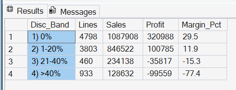

> **Finding:** Margin stays positive at 0% (**+29.5%**) and 1–20% (**+11.9%**), then turns negative at **−15.3%** (21–40%) and **−77.4%** (>40%). The >40% band alone destroys **$99,559** across 933 lines.
> **Means:** 🚨 Clear discount threshold — beyond 20%, each sale destroys value.

---

### Q5. Loss-Making Sub-Categories

**Business Question:** Which sub-categories are responsible for the overall losses?

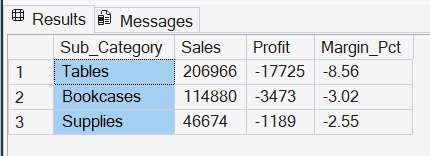

> **Finding:** **Tables −$17,725**, **Bookcases −$3,473**, **Supplies −$1,189**. Combined loss **−$22,387**; Tables alone ≈ 79% of it.
> **Means:** A short, named list of loss drivers — actionable by a category manager on Monday morning.

---

### Q6. Top 3 Products in Each Category

**Business Question:** Are the highest-selling products also the most profitable?

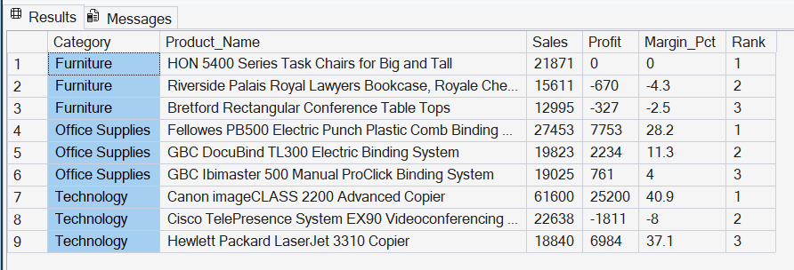

> **Finding:** 4 of the 9 top-sellers by revenue earn **zero or negative** profit. All three top Furniture products: **$0, −$670, −$327**. Technology’s #2 seller (Cisco TelePresence EX90) loses **−$1,811**. Top seller overall — Canon imageCLASS 2200 Copier — earns **$25,200 at 40.9%** margin.
> **Means:** Best-sellers must be cross-checked against margin before being promoted further.

---

### Q7. Year-over-Year Sales vs Profit Growth

**Business Question:** Is sales growth translating into profit growth?

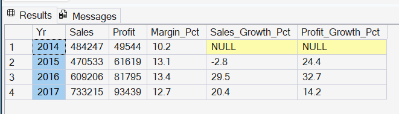

> **Finding:** Sales grew from **$484K (2014)** to **$733K (2017)** — about **+51%**. Profit grew from **$50K to $93K** — about **+89%**. Margin rose 10.2% → 12.7% over the period, peaking at **13.4% in 2016** before slipping to **12.7% in 2017** (when profit growth +14% lagged sales growth +20%). 2015 is the interesting year: sales fell **−2.8%** while profit rose **+24.4%**.
> **Means:** The business scaled profitably overall — but 2017’s margin slip flags that recent growth is less efficient. Volume growth alone is not the full success story; discount discipline still decides whether growth converts to profit.

---

### Q8. Financial Impact of Discounts Above 20%

**Business Question:** How much profit is associated with transactions receiving discounts above 20%?

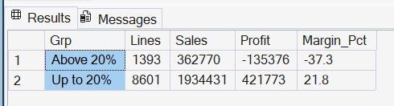

> **Finding:** **Above 20%** band: **1,393 lines** (13.9% of all lines), **$362,770 sales** (15.8%), **−$135,376 profit (−37.3% margin)**. **Up to 20%** band: 8,601 lines, $1,934,431 sales, **+$421,773 profit (+21.8% margin)**. The above-20% loss equals **~47% of total company profit**.
> **Means:** Quantifies the exact cost of over-discounting — the number that makes “cap discounts at 20%” defensible to leadership.

---

### Q9. Bottom 10 States by Profit

**Business Question:** Which states are contributing most to geographical profit leakage?

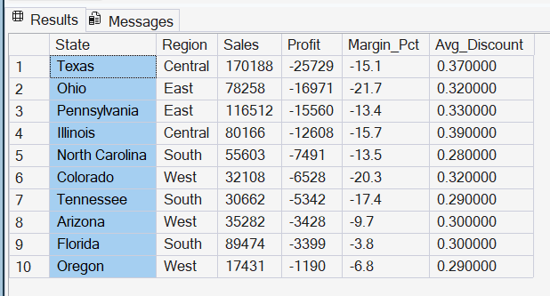

> **Finding:** Worst states by profit: **Texas −$25,729 (Central)**, **Ohio −$16,971 (East)**, **Pennsylvania −$15,560 (East)**, **Illinois −$12,608 (Central)**. Texas + Illinois together lose **−$38,337** — almost equal to the entire Central region’s profit ($39,706). All ten bottom states run average discounts of **0.28–0.39** vs company average **0.16**.
> **Means:** Region-level view (Q2) hides state-level pain. East’s headline margin looks healthy only because winners mask Ohio/Pennsylvania. Central’s weakness is concentrated in Texas and Illinois.

---

### Q10. Sub-Category vs Discount Band Analysis

**Business Question:** Are products losing money because of their pricing structure, or because of excessive discounts?

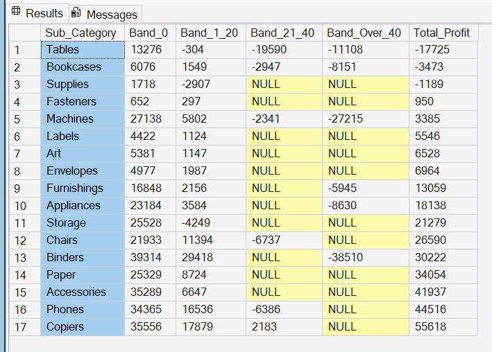

**Key Findings:**

- All 17 sub-categories were profitable at 0% discount.
- Tables generated $13,276 profit at 0% discount but started losing money even in the 1–20% band.
- Binders remained profitable up to 40% discount but lost heavily above 40%.
- Machines experienced significant losses at higher discount levels.
- Phones lost approximately $6,386 in the 21–40% discount band.
- Copiers remained profitable across the discount bands in which they appeared.
- Supplies and Storage already showed losses in the 1–20% discount band.

**Business Takeaway:**

Not every loss-making product has the same problem.

Some products need better pricing and cost management even at moderate discounts, while others mainly need stricter discount controls.

This query helped separate these two types of profitability problems.

---

## 8. Data Modeling

After completing the SQL analysis, I connected SQL Server to Power BI.

Instead of using the entire dataset as a single flat table, I created a Star Schema inside Power BI using calculated dimension tables.

The SQL view `v_superstore` acts as the central fact table.

### Fact Table

`v_superstore`

### Dimension Tables

| Dimension    | Key          |
| ------------ | ------------ |
| Dim_Date     | Date         |
| Dim_Customer | Customer_ID  |
| Dim_Product  | Product_Key  |
| Dim_Location | Location_Key |

### Star Schema Relationships

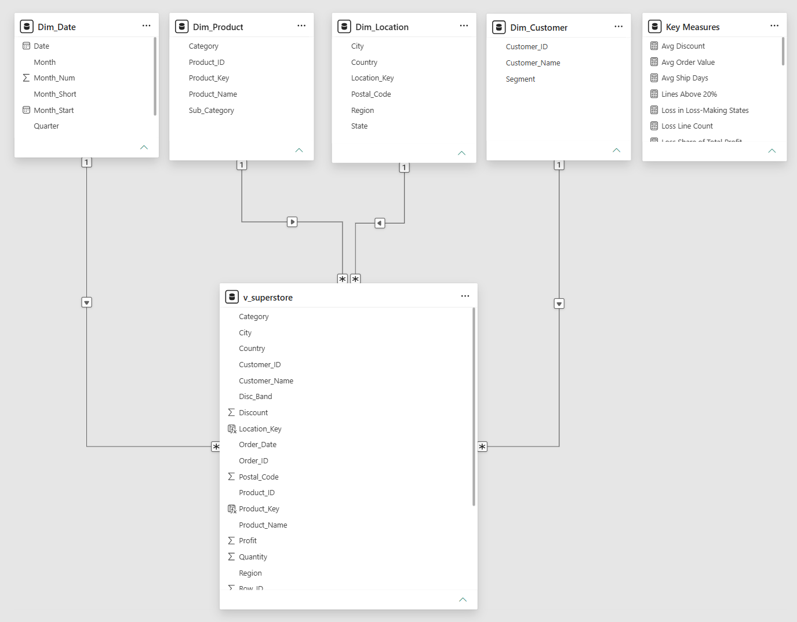

All relationships are one-to-many with single-direction filtering.

```
                 Dim_Date
                    |
                    |
Dim_Customer ---- v_superstore ---- Dim_Product
                    |
                    |
               Dim_Location
```

The dimensions filter the central fact table.

This structure keeps the model organised and supports consistent filtering across the report.

---

## 9. SQL View

I created a reusable SQL view named `v_superstore`.

The purpose was to centralise two derived columns that were needed by multiple downstream calculations.

- Ship_Days
- Disc_Band

```
CREATE VIEW v_superstore AS

SELECT
    *,
    DATEDIFF(
        DAY,
        Order_Date,
        Ship_Date
    ) AS Ship_Days,

    CASE
        WHEN Discount = 0 THEN '1) 0%'
        WHEN Discount <= 0.2 THEN '2) 1-20%'
        WHEN Discount <= 0.4 THEN '3) 21-40%'
        ELSE '4) >40%'
    END AS Disc_Band

FROM superstore;
```

I intentionally kept the view limited to these two shared calculations. Other calculations, such as YoY growth, MoM growth and profit margin, were kept in the queries or DAX measures where they were needed.

This kept the view simple and easier to maintain.

---

## 10. DAX Measures

I created measures for the report's main KPIs, profitability calculations, customer analysis, geography and time intelligence.

Some of the core measures are shown below.

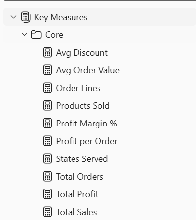

I also created corresponding profit and order growth measures.

### Why I Used Measures

Measures allow calculations to respond dynamically to report filters and slicers.

For example, selecting a particular region or category changes the sales, profit and margin calculations automatically.

I used `DIVIDE()` for safe division instead of relying on direct division in measures where the denominator could be zero.

---

## 11. Power BI Dashboard — Seven-Page Report

The final report is designed as an executive-style interactive business intelligence application.

The report uses a Midnight Dark theme, custom SVG backgrounds, a global filter bar and interactive navigation.

Each page has a specific business purpose.

### Dashboard Navigation

| Page | Name                                     |
| ---- | ---------------------------------------- |
| 00   | Executive Cover & Data Trust Pipeline    |
| 01   | Executive Overview                       |
| 02   | Profit Leakage & Discount Governance     |
| 03   | Regional & Geospatial Hotspots           |
| 04   | Customer & Shipping Intelligence         |
| 05   | Product Portfolio & Inventory Health     |
| 06   | Strategic Simulation & Predictive Studio |

### Page 00 — Executive Cover & Data Trust Pipeline


This page introduces the report and gives the user a quick view of the project's financial baseline.

**Main Elements:**

- Total Sales: $2.30M
- Total Profit: $286.40K
- Profit Margin: 12.47%
- Data reconciliation highlights.
- Discount profitability insight.
- Navigation button to the main report.

The page also presents the complete data pipeline:

Kaggle → SQL Server → Excel Reconciliation → Star Schema → Power BI → Business Insights.

### Page 01 — Executive Overview

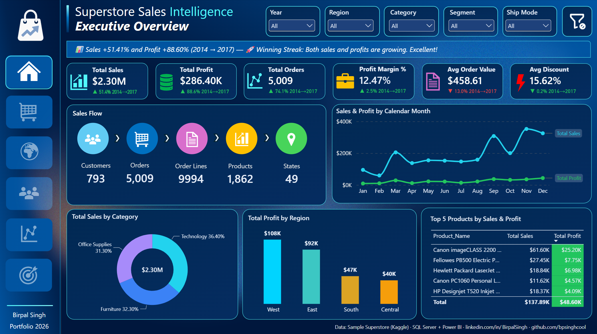

**Business Question:** How is the business performing overall?

**Main Elements:**

- Six KPI cards.
- Dynamic business insight banner.
- Sales and profit trend across 48 months.
- Category contribution donut chart.
- Regional profit comparison.
- Top five products by sales.
- Business footprint overview.

The page also includes custom report-page tooltips and dynamic YoY comparisons.

**Main Insight:**

Sales increased by approximately 51% between 2014 and 2017, while profit increased by approximately 89%. However, average order value declined as order volume grew faster than revenue.

### Page 02 — Profit Leakage & Discount Governance

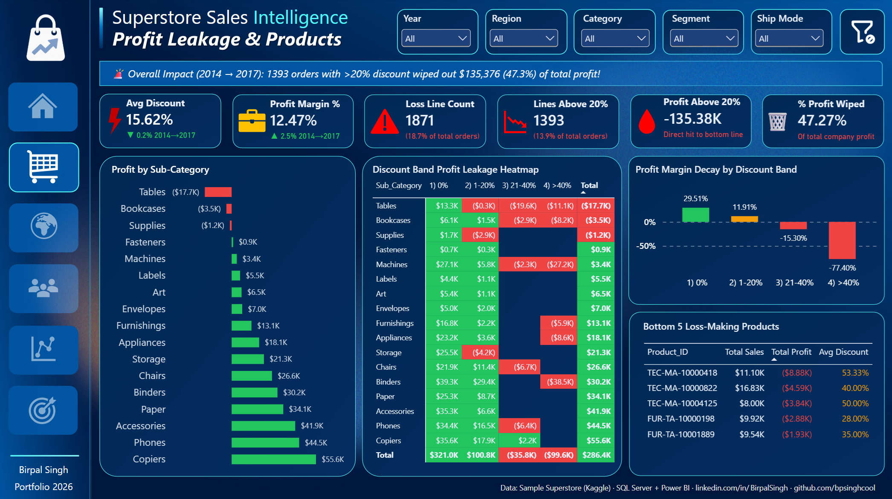

**Business Question:** Where is the business losing profit?

**Main Elements:**

- Discount alert banner.
- Average discount KPI.
- Profit margin KPI.
- Loss-making order line count.
- Transactions above 20% discount.
- Profit associated with above-20% discount transactions.
- Sub-category profitability chart.
- Discount-band heatmap matrix.
- Margin decay chart.
- Bottom five loss-making products.

**Main Insight:**

The above-20% discount group generated a loss of approximately $135.38K across 1,393 order lines.

The matrix also shows that some sub-categories become unprofitable even at relatively moderate discount levels.

### Page 03 — Regional & Geospatial Hotspots

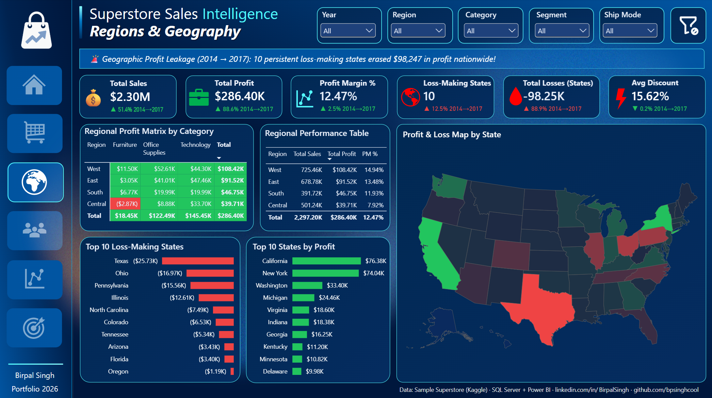

**Business Question:** Which geographical areas are contributing to profit leakage?

**Main Elements:**

- Total Sales and Total Profit.
- Profit Margin %.
- Loss-making state count.
- Total loss across loss-making states.
- USA state-level profit map.
- Top ten loss-making states.
- Top ten profitable states.
- Region versus category profitability matrix.
- Regional performance table.

**Main Insight:**

Ten states generated combined losses of approximately $98.25K.

Texas alone contributed approximately $25.73K in losses, while Central region profitability remained significantly below the other regions.

### Page 04 — Customer & Shipping Intelligence

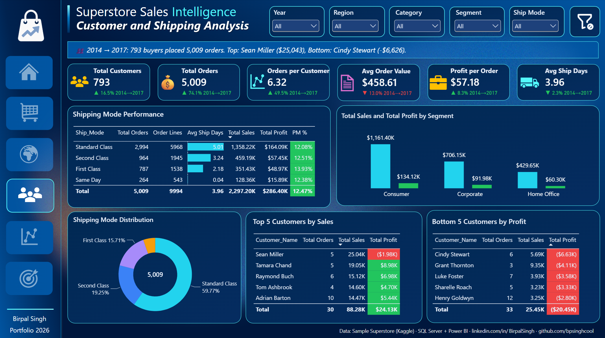

**Business Question:** Who are the customers generating revenue, and are those relationships profitable?

**Main Elements:**

- Total Customers.
- Total Orders.
- Orders per Customer.
- Average Order Value.
- Profit per Order.
- Average Shipping Days.
- Shipping mode performance table.
- Customer segment comparison.
- Shipping mode distribution.
- Top five customers by sales.
- Bottom five customers by profit.

**Main Insight:**

Sean Miller ranked as the highest-revenue customer, with approximately $25K in sales across five orders, but generated a net loss of approximately $1.98K.

Cindy Stewart was the largest loss-making customer, with a loss of approximately $6.63K.

This page highlights why customer revenue should always be viewed alongside customer profitability.

### Page 05 — Product Portfolio & Inventory Health

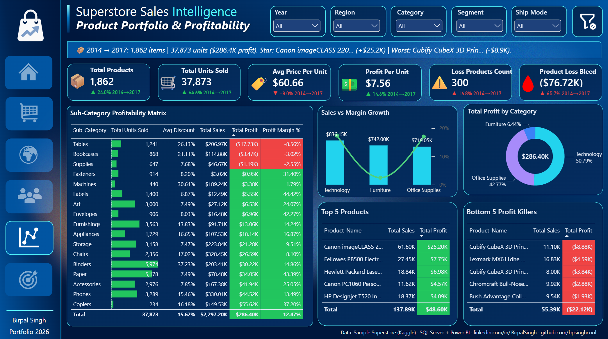

**Business Question:** Which products contribute to profit, and which products are reducing overall profitability?

**Main Elements:**

- Total Products.
- Total Units Sold.
- Average Price per Unit.
- Profit per Unit.
- Loss-making product count.
- Product loss impact.
- Sub-category profitability matrix.
- Category sales versus margin comparison.
- Category profit contribution.
- Top five profitable products.
- Bottom five loss-making products.

**Main Insight:**

Furniture generated approximately $742K in sales but contributed only $18.45K in profit, representing a margin of just 2.49%.

Technology contributed approximately 50.79% of total company profit.

The Cubify CubeX 3D Printer Double Head was among the worst-performing products, generating a loss of approximately $8.88K across nine units.

### Page 06 — Strategic Simulation & Predictive Studio

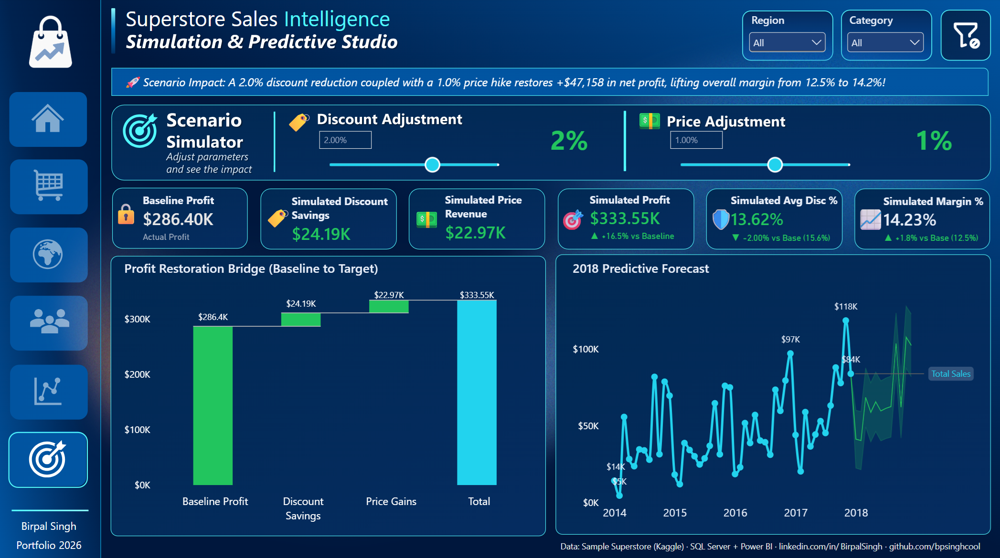

This is the final page of the report and was designed to move beyond historical analysis.

**Business Question:** What could happen to profitability if the business improves discount management and adjusts pricing?

**Main Elements:**

- Baseline Profit.
- Simulated Discount Savings.
- Incremental Price Revenue.
- Simulated Profit.
- Simulated Average Discount.
- Simulated Profit Margin.
- Interactive discount adjustment slider.
- Interactive price adjustment slider.
- Profit restoration waterfall chart.
- 12-month forward forecast.
- 95% confidence interval.
- Reset to Baseline bookmark button.

#### Interactive What-If Simulation

The report includes two independent What-If parameters:

1. Discount Adjustment.
2. Price Adjustment.

These allow users to change assumptions and see how the simulated profitability changes.

The simulation also includes a custom waterfall bridge:

Baseline Profit → Discount Savings → Price Gains → Simulated Profit.

#### Simulation Results

| Scenario                | Discount Change | Price Change | Profit Uplift | Simulated Profit | Margin |
| ----------------------- | --------------- | ------------ | ------------- | ---------------- | ------ |
| Baseline                | 0%              | 0%           | $0            | $286,397         | 12.47% |
| Moderate Governance     | -1%             | +1%          | $35,065       | $321,462         | 13.78% |
| Balanced Policy         | -2%             | +1%          | $47,158       | $333,555         | 14.23% |
| Aggressive Recovery     | -5%             | +2%          | $106,409      | $392,806         | 16.34% |
| Maximum Governance Test | -10%            | 0%           | $120,930      | $407,327         | 16.84% |

**Balanced Policy Example:**

- Discount reduction: 2%.
- Price increase: 1%.
- Discount savings: approximately $24,186.
- Additional price revenue: approximately $22,972.
- Total simulated profit uplift: approximately $47,158.
- Simulated profit: approximately $333,555.
- Simulated profit margin: 14.23%.

These are scenario-based estimates using the assumptions built into the model, not guaranteed future financial results.

#### 2018 Predictive Forecast

The page also includes a 12-month Holt-Winters Additive Seasonality forecast based on the historical monthly sales pattern from 2014 to 2017.

The forecast visual includes:

- Historical monthly sales.
- Forecasted 2018 monthly values.
- 95% confidence interval.
- Actual versus forecast visual distinction.
- Seasonal patterns around the year-end period.

**Important:** The forecast is based on historical data ending in 2017. It is an analytical exercise, not a prediction of actual present-day retail performance.

---

## 12. Dashboard Design & User Experience

I wanted the report to feel more like a small business intelligence application rather than a collection of unrelated charts.

For this reason, I used a consistent design system across all seven pages.

### Design Choices

| Element              | Design                           |
| -------------------- | -------------------------------- |
| Theme                | Midnight Dark                    |
| Background           | Deep Navy                        |
| Primary Accent       | Cyan                             |
| Positive Performance | Green                            |
| Negative Performance | Red                              |
| Typography           | Clean, modern and readable       |
| Background Elements  | SVG-based layouts                |
| Navigation           | Interactive left-side navigation |
| Filters              | Global synchronized filter bar   |

### Usability Features

**Global Filter Bar**

The report includes common filters for:

- Date Range
- Region
- Category
- Segment
- Ship Mode

A Clear Filters action is also available.

**Left-Side Navigation**

Users can navigate between the report pages without depending on the standard Power BI page tabs.

**Dynamic Insight Banners**

Instead of displaying only static headings, the report uses DAX-driven text to communicate what is happening under the current filter selection.

**Custom Tooltips**

I created report-page tooltips for additional information without making the main dashboard unnecessarily crowded.

**Conditional Formatting**

The report uses consistent business colour logic:

- Green for positive profit.
- Red for losses and negative margins.
- Cyan for important figures and highlights.

**Full Design Specification:** See Design.md for the detailed report layout, SVG backgrounds, colour system and design specifications.

---

## 13. SQL Server vs Power BI Reconciliation

After building the dashboard, I performed another reconciliation between SQL Server and Power BI.

The purpose was to confirm that the main report figures matched the SQL source.

### Final Control Totals

| Metric       | SQL Server    | Power BI      |
| ------------ | ------------- | ------------- |
| Total Sales  | $2,297,200.86 | $2,297,200.86 |
| Total Profit | $286,397.02   | $286,397.02   |
| Total Rows   | 9,994         | 9,994         |

SQL verification query:

```
SELECT
    ROUND(SUM(Sales), 2) AS Total_Sales,
    ROUND(SUM(Profit), 2) AS Total_Profit,
    COUNT(*) AS Total_Rows
FROM superstore;
```


The main financial totals and row count matched between SQL Server and Power BI.

This was an important final check because the report's purpose is to support business decisions, not just display attractive visuals.

---

## 14. Key Findings From the Project

After completing the SQL queries and Power BI analysis, these were the most important findings.

| Area         | Finding                                                                                                 |
| ------------ | ------------------------------------------------------------------------------------------------------- |
| Discounting  | Transactions above 20% discount generated a combined loss of approximately $135.38K                     |
| Sub-Category | Tables, Bookcases and Supplies generated a combined loss of approximately $22.39K                       |
| Products     | Four of the nine top-selling products by category generated zero or negative profit                     |
| Region       | West generated the highest regional profit                                                              |
| Geography    | Ten states generated approximately $98.25K in combined losses                                           |
| Customers    | The highest-sales customer was not necessarily profitable                                               |
| Furniture    | Approximately $742K in sales generated only a 2.49% margin                                              |
| Technology   | Contributed approximately 50.79% of overall company profit                                              |
| Seasonality  | September, November and December were strong sales months                                               |
| Simulation   | A 2% discount reduction and 1% price increase produced a modeled profit uplift of approximately $47.16K |

---

## 15. Business Recommendations

Based on the findings, I identified the following areas that management could investigate.

| Business Area          | Recommendation                                                                                |
| ---------------------- | --------------------------------------------------------------------------------------------- |
| Discount Management    | Review transactions above 20% discount and introduce an approval process for larger discounts |
| Furniture              | Investigate Tables pricing, shipping costs and vendor arrangements                            |
| Regional Performance   | Review discounting and product mix in Texas and Illinois                                      |
| Customer Profitability | Evaluate customer-level margins rather than focusing only on revenue                          |
| Product Portfolio      | Review persistently loss-making products, including the Cubify 3D printer range               |
| Seasonal Planning      | Plan inventory and promotions around the stronger September–December period                   |

These recommendations are based on the historical dataset and should be evaluated against actual operating costs, customer demand and commercial constraints before implementation.

---

## 16. Limitations & Assumptions

A few points are important when interpreting this analysis.

- The dataset covers 2014–2017, so the findings should not be treated as a representation of current retail market conditions.
- The analysis identifies associations between discount levels and profitability. It does not independently establish that discounting alone caused every loss.
- One identical duplicate record pair from the source was retained and its impact documented.
- Sales and Profit were retained as FLOAT in the SQL table. Their displayed results were rounded to two decimal places. A production financial system should use appropriate DECIMAL data types.
- The What-If simulation uses defined assumptions, including price pass-through. Actual commercial results could differ.
- The Holt-Winters forecast uses historical monthly patterns and should not be interpreted as a guaranteed future outcome.
- The findings apply to the Sample Superstore dataset and should not be generalised to every retail business.

---

## 17. 💻 How to Run This Project

### Prerequisites

You will need:

- SQL Server Express
- SQL Server Management Studio (SSMS)
- Microsoft Power BI Desktop
- Microsoft Excel

### Step 1 — Download the Repository

```
git clone https://github.com/bpsinghcool/Superstore-Sales-Profitability-Analysis.git
```

Alternatively, download the repository as a ZIP file from GitHub.

### Step 2 — Download the Dataset

Download the Sample Superstore dataset from:

[Sample Superstore Dataset – Kaggle](https://www.kaggle.com/datasets/vivek468/superstore-dataset-final)

Place the CSV file in the `data` folder.

### Step 3 — Create the SQL Database

Open SSMS and execute:

```
CREATE DATABASE SuperstoreDB;
```

Import the CSV using:

**Database → Tasks → Import Flat File**

Use `superstore` as the table name and configure the required data types.

### Step 4 — Perform Data Checks

Execute:

`sql/00_data_checks_and_fixes.sql`

This script contains the validation queries and documented corrections.

Compare the final totals against the baseline values in this README.

### Step 5 — Create the SQL View

Execute:

`sql/01_create_view.sql`

This creates the `v_superstore` view.

### Step 6 — Execute the Business Queries

Execute:

- `sql/02_Q1_Q5.sql`
- `sql/03_Q6_Q10.sql`

Review the query results and compare them with the documented findings.

### Step 7 — Open the Power BI Report

Open:

`powerbi/Superstore_Dashboard.pbix`

If you are rebuilding the report, connect Power BI Desktop to:

| Setting         | Value                  |
| --------------- | ---------------------- |
| Server          | `localhost\SQLEXPRESS` |
| Database        | `SuperstoreDB`         |
| Connection Mode | Import                 |
| Table/View      | `v_superstore`         |

Create the dimension tables, relationships and DAX measures as documented above.

### Step 8 — Verify the Final Results

Run the SQL reconciliation query and compare the results with the Power BI KPI cards.

The baseline should match:

- Sales: $2,297,200.86
- Profit: $286,397.02
- Rows: 9,994

---

## 18. 📁 Repository Structure
```text
Superstore-Sales-Profitability-Analysis/
├── data/
│   ├── superstore.csv
│   ├── superstore_excel_testing_file.xlsx # EXCEL TESTING FILE.
│   └── SOURCE.md                      # Kaggle link + credit
├── design/
│   ├── BackgrounDesign.pptx
│   ├── Superstore_Midnight_Theme.json
│   ├── Cover.svg
│   ├── Customers.svg
│   ├── Overview.svg
│   ├── Products.svg
│   ├── Profit.svg
│   ├── Regions.svg
│   ├── Simulator.svg
│   └── images/
│        └── filter_cancel.png
│        └── superstore_logo.png
├── sql/
│   ├── 00_data_checks_and_fixes.sql
│   ├── 01_create_view.sql             # v_superstore (Ship_Days + Disc_Band)
│   ├── 02_Q1_Q5.sql
│   └── 03_Q6_Q10.sql
├── powerbi/
│   └── Superstore_Sales_Intelligence_2026.pbix
├── screenshots/
│   ├── 00_dataset_source.png
│   ├── 01_import_data_error_NULL_msg.png
│   ├── 01_import_data_Warning_msg.png
│   ├── 02_data_checks_null_profit_row_7345.png
│   ├── 02_data_checks_row_data_row_7345.png
│   ├── 02_data_checks_duplicates_values.png
│   ├── 02_data_checks_duplicates_impact.png
│   ├── 02_data_checks_floating_point_check.png
│   ├── 02_data_checks_float_to_decimal_fix.png
│   ├── 02_data_checks_discount_proof.png
│   ├── 02_data_checks_distinct_discount_check.png
│   ├── 05_q01_category_margin.png
│   ├── 05_q02_region_performance.png
│   ├── 05_q03_monthly_trend.png
│   ├── 05_q03b_peak_and_drop_months.png
│   ├── 05_q04_discount_impact.png
│   ├── 05_q05_loss_subcategories.png
│   ├── 05_q06_top_products.png
│   ├── 05_q07_yoy_trend.png
│   ├── 05_q08_discount_cost.png
│   ├── 05_q09_bottom_states.png
│   ├── 05_q10_subcat_discount_matrix.png
│   ├── core_measures.png
│   ├── 09_powerbi_datamodel.png
│   ├── 00_cover_page.png
│   ├── 01_executive_overview.png
│   ├── 02_profit_leakage.png
│   ├── 03_regions_geography.png
│   ├── 04_customer_intelligence.png
│   ├── 05_product_profitability.png
│   └── 06_simulation_predictive_studio.png
└── README.md
└── Project_Logs.txt
```

---

## 19. What I Learned

This project gave me practical experience beyond writing SQL queries and creating Power BI visuals.

Some of the most useful things I worked through were:

**1. Data Quality Matters More Than I Initially Thought**

I learned that data can look perfectly fine after import while still containing missing or incorrectly converted values. Checking the source and reconciling financial totals is essential.

**2. Understanding FLOAT vs DECIMAL**

The 20% discount comparison issue was a good example of how a seemingly small data-type decision can affect an entire business analysis.

**3. Investigating Duplicates Before Removing Them**

I learned to distinguish legitimate repeated transactions from actual duplicate records.

**4. Writing Business-Oriented SQL Queries**

Instead of writing queries just to practise SQL syntax, I started with business questions and then decided which SQL techniques were needed to answer them.

**5. Using Window Functions**

Working with `LAG()` and `ROW_NUMBER()` helped me understand how SQL can handle time-based comparisons and ranking within groups.

**6. Building a Proper Power BI Data Model**

Creating separate dimensions and a central fact table gave me a better understanding of relationships, filter direction and model design.

**7. Writing DAX for Real Reporting Requirements**

I worked with measures that respond to slicers, calculate growth, compare periods and support dynamic report storytelling.

**8. Reconciliation Between SQL and Power BI**

I learned not to assume that a dashboard is correct simply because its visuals look right. The figures should be checked against the underlying data.

**9. Designing Reports Around Business Questions**

Each page of the report has a specific purpose. I tried to make the insights easy to understand without forcing the user to interpret dozens of unrelated charts.

**10. Moving From Reporting to Decision Support**

The final simulation page helped me explore how historical analysis can be used to test business scenarios rather than simply describe what has already happened.

---

## 20. 💡 Final Thoughts

When I started this project, the idea was to build a sales dashboard using SQL Server and Power BI.

But as I started checking the data and investigating the numbers, the project gradually became something more interesting: a profitability analysis.

The most valuable part was not creating the charts. It was finding the issues in the source data, understanding why some calculations were not working as expected, validating the numbers and then connecting those findings to actual business questions.

A few things I am particularly happy with:

- Identifying and correcting the import issue that changed a valid profit value to NULL.
- Finding the FLOAT precision problem that could have distorted the discount analysis.
- Reconciling SQL Server results with the original Excel source.
- Identifying products and geographical areas that were generating losses.
- Building a Star Schema rather than relying on a single flat table.
- Creating an interactive seven-page Power BI report.
- Adding What-If simulation and historical seasonal forecasting.

For me, this project was a useful step in moving from traditional MIS and reporting work towards more analytical, SQL-based reporting and business intelligence.

The dashboard is the final output, but the data checks, SQL analysis and reconciliation are what make the numbers worth trusting.

---

## Let's Connect

I am interested in opportunities involving MIS Reporting, SQL Reporting, Power BI and Business/Data Analytics.

If you have any feedback or suggestions about this project, I would genuinely appreciate hearing them.

<div align="center">
  <i>"Open to opportunities in Remote MIS / Data Reporting / Business Operations roles. Let's connect!"</i>
  <br><br>
  <b>Developed by Birpal Singh</b><br>
  <i>15+ years in MIS & Reporting — extending into SQL Server analytics and Power BI</i>
  <br><br>
  <a href="https://www.linkedin.com/in/BirpalSingh">🔗 LinkedIn Profile</a> |
  <a href="https://github.com/bpsinghcool">🐙 GitHub Profile</a>
</div>
